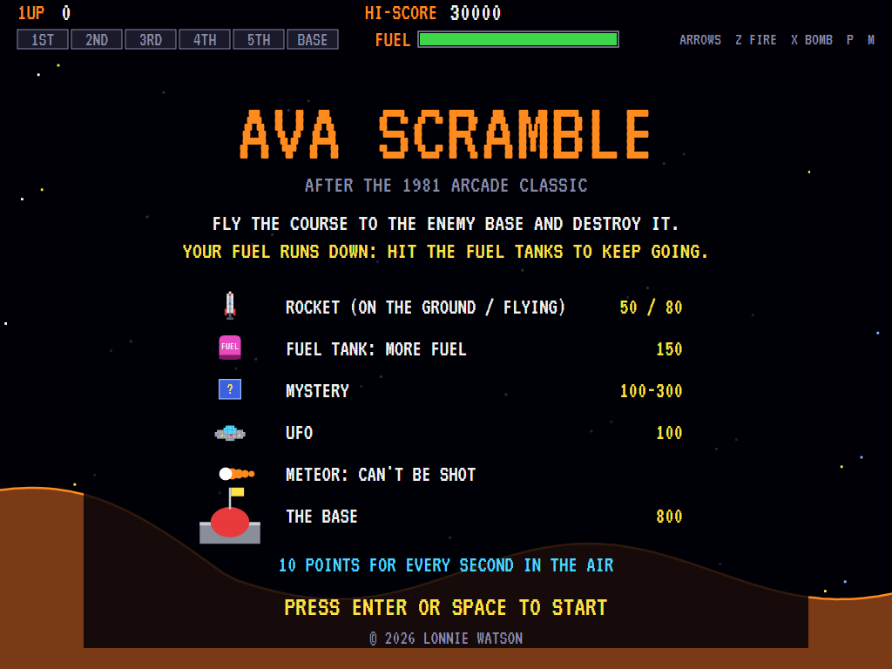
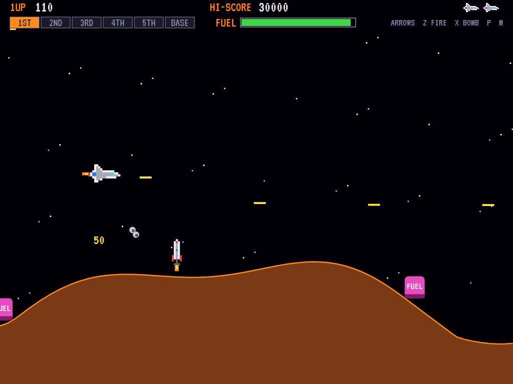
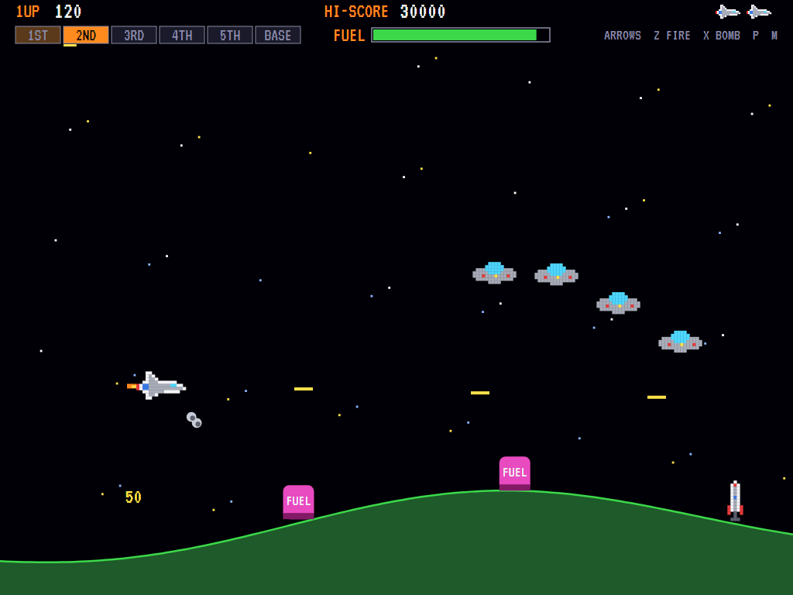
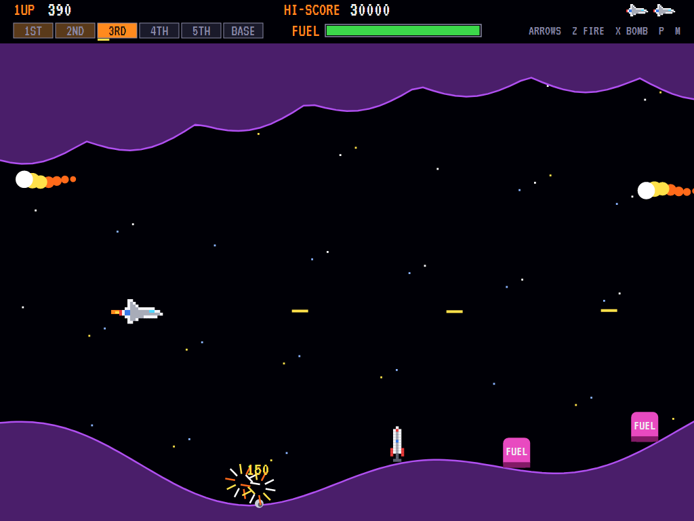
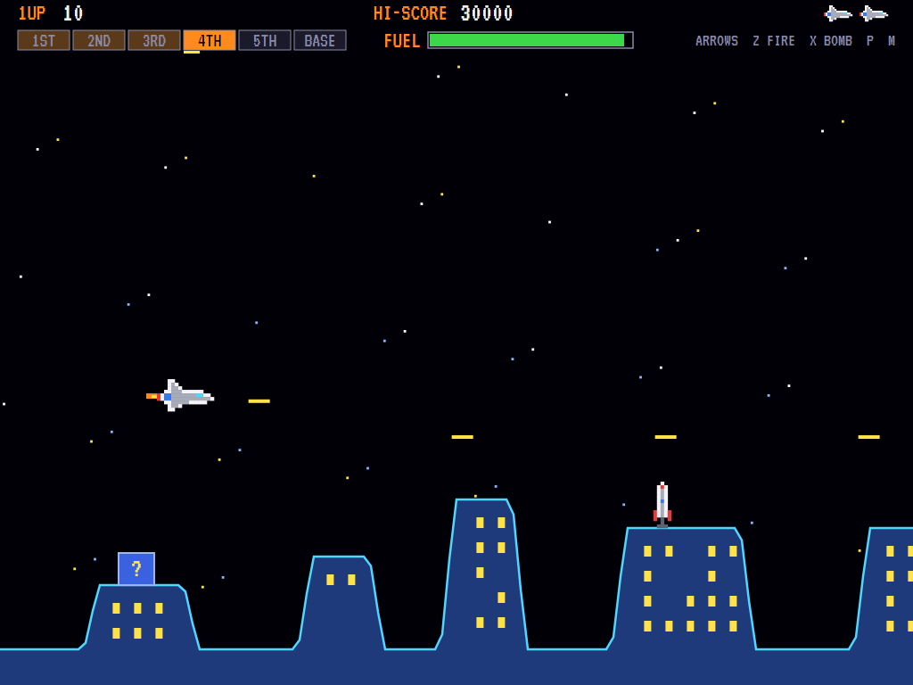
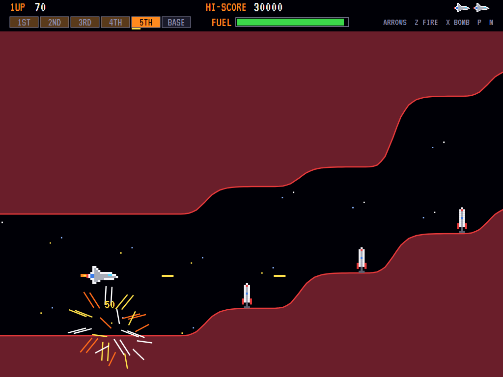
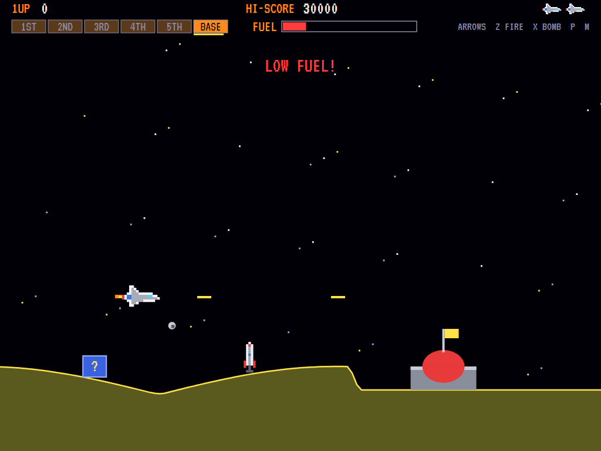

# AVAScramble

[](https://github.com/Harlock123/AVAScramble/actions/workflows/build.yml)

A side-scrolling shooter in the style of Konami's 1981 arcade game **Scramble**, built with .NET 10
and Avalonia UI. Fly your jet low over the ground through six stages to the enemy base, with the laser
for what's ahead and bombs for what's below. Your fuel never stops running down, so you have to keep
hitting fuel tanks to stay in the air.

## Features

- **Six stages**, each with its own ground and its own danger:
  1. **Mountains**: rockets take off as you come near.
  2. **UFO Valley**: saucers weave in, in waves.
  3. **Meteor Caves**: a roof as well as a floor, and meteors that can't be shot.
  4. **The City**: tower blocks to fly between, rockets on the rooftops.
  5. **The Maze**: a tunnel that winds and narrows.
  6. **The Base**: blow up the base at the end. Miss it and you fly the last stage again.

  Then round again, with the fuel running out faster.
- **Fuel**: the gauge runs down all the time. Hit a fuel tank (with the laser or a bomb) to top it
  up. Run dry and the jet drops out of the sky.
- **Two weapons**: the laser fires straight ahead. Bombs are thrown forward and fall in an arc, two
  in the air at a time. Both destroy anything on the ground.
- **Points**: 50 for a rocket on the ground and 80 in flight, 150 for a fuel tank, 100, 200 or 300
  for a mystery, 100 for a UFO and 800 for the base. On top of that you get 10 points for every second
  you stay in the air.
- **The course**: ground, cave roofs, tower blocks and the maze are all worked out from the stage
  number, so they're the same every time. The tests check there's always room to fly through.
- **Sound**: the jet's engine drone, the laser, the bombs whistling down, the rockets taking off,
  the low-fuel alarm, and an original title tune and fanfares, all mixed by OpenAL.
- **Attract mode**: leave the title alone for 15 seconds and a computer player plays a demonstration.
  It flies low over open ground and down the middle of caves and the maze. It works out where a bomb
  dropped now would land (allowing for the scroll) and drops one on fuel, rockets and mysteries, and
  it dodges up or down out of the way of what's coming. It flies every stage and destroys the base.
- **Three ships**, an extra one at 10,000, and a **top-ten high-score table** with arcade-style
  initials entry. The table records how far you got.
- **Any window size**: the screen scales to fit, letterboxed. **Ctrl+S** saves a screenshot.
- **One self-contained executable** per platform: Windows, macOS and Linux on Intel/AMD and ARM.

## Screenshots

| Title screen | The mountains | UFO Valley |
|:------------:|:-------------:|:----------:|
|  |  |  |
| What's what, and what it's worth. | A rocket taking off, a bomb on its way down. | A wave of saucers. |

| The meteor caves | The city | The maze |
|:----------------:|:--------:|:--------:|
|  |  |  |
| Meteors streaking through. | Tower blocks and a rooftop rocket. | The tunnel winding up. |



*The base, fuel running low.*

The screenshots are made by the tests, which play the game in a real (headless) window; see
[Tests](#tests).

## Download and run

Ready-to-run builds for Windows, macOS and Linux, on both Intel/AMD and ARM, are on the
[Releases page](https://github.com/Harlock123/AVAScramble/releases/tag/latest). **Latest build** is
rebuilt on every push to `main`. Each download is one self-contained executable: no .NET install is
needed.

| Platform | Archive |
|---|---|
| Windows | `AVAScramble-win-x64.zip`, `AVAScramble-win-x86.zip`, `AVAScramble-win-arm64.zip` |
| macOS | `AVAScramble-osx-arm64.tar.gz` (Apple silicon), `AVAScramble-osx-x64.tar.gz` (Intel) |
| Linux | `AVAScramble-linux-x64.tar.gz`, `AVAScramble-linux-arm64.tar.gz`, `AVAScramble-linux-arm.tar.gz` |

```bash
tar -xzf AVAScramble-linux-x64.tar.gz     # or linux-arm64, linux-arm, osx-arm64, osx-x64
./AVAScramble
```

On Windows, unzip and run `AVAScramble.exe`. On macOS, if Gatekeeper refuses to open it, run
`xattr -d com.apple.quarantine AVAScramble` once. Run with `--no-audio` for silence.

**Sound** comes through OpenAL Soft, built in for every platform. In a virtual machine the game
detects it and uses a larger audio buffer, so the sound doesn't break up.

**Gamepads** use SDL2, which is bundled for Windows, macOS and Intel/AMD Linux. ARM Linux builds need it
installed; without it the keyboard still works:

```bash
sudo apt install libsdl2-dev            # Debian / Ubuntu / Raspberry Pi OS
sudo pacman -S --needed sdl2-compat     # Arch / Omarchy
```

## Controls

| Input | Action |
|-------|--------|
| **Arrow keys** / **WASD** / number pad | Fly |
| **Z** / **Space** / **Ctrl** (hold) | Laser |
| **X** / **Shift** / **Alt** | Bomb (two in the air at a time) |
| **Enter** / **Space** | Start a game |
| **P** / **Esc** | Pause (Esc again to quit) |
| **M** | Mute |
| **Ctrl+S** / **Cmd+S** | Save a screenshot to the Pictures folder |

**Gamepad**: left stick or D-pad to fly, **A** or the right trigger for the laser, **B**, **X** or the
left trigger to bomb; **Start** or **A** starts, **Start** pauses, **Back** (while paused) quits.

**Entering initials**: type letters, or dial with **Up**/**Down** and accept with **Space**; **Left** /
**Backspace** go back; **Enter** finishes.

## Tests

```bash
dotnet test AVAScramble.slnx
```

The engine has no UI and runs in fixed 60 Hz steps, so it plays the same at any frame rate, and a seed
always plays the same game. The tests check:

- every stage leaves room to fly and has fuel and targets, and the stages follow one another;
- the laser against flyers, ground targets and meteors; bombs falling forward and hitting, two at a
  time;
- fuel running down and the jet dropping when it's gone; hitting the ground and the roof;
- rockets taking off where they should (and not elsewhere), UFO waves, meteors, mysteries;
- destroying the base (and missing it); points for time in the air and the extra ship;
- the title tune, the demonstration's sound, pausing, and every sound and sprite.

A computer player (the attract-mode one) plays whole games in them and must get into the third stage.

The screenshot tests draw the real screen in a headless window. To refresh the README's pictures:

```bash
SCRAMBLE_SHOTS=$PWD/Images dotnet test tests/AVAScramble.Tests --filter ScreenshotTests
```

## Building

```bash
dotnet build AVAScramble.slnx
dotnet run --project src/AVAScramble
```

Needs the .NET 10 SDK. The sounds are made by `tools/make_sounds.py` (standard-library Python):
`python3 tools/make_sounds.py` rewrites `src/AVAScramble/Sounds`.

## Project structure

```
AVAScramble/
├── AVAScramble.slnx
├── src/AVAScramble/
│   ├── Engine/
│   │   ├── GameEngine.cs        # States, scoring, the extra ship and the engine's drone
│   │   ├── GameEngine.Play.cs   # Scrolling, fuel, the jet, laser and bombs, things on the ground,
│   │   │                        # rockets, UFOs and meteors, crashes, the stages and the base
│   │   ├── Entities.cs          # The jet, shots, bombs, ground targets and flyers
│   │   ├── AttractPilot.cs      # The computer player for the demonstration (and the tests)
│   │   ├── HighScoreTable.cs, InitialsEntry.cs
│   │   ├── InputHandler.cs, ControllerManager.cs  # Keys and an SDL2 gamepad
│   │   └── SoundManager.cs      # Effects, the drone and the tunes through OpenAL
│   ├── Audio/                   # The OpenAL engine (from the author's AVABand)
│   ├── Models/                  # The field, the six stages' course, and the pixel art
│   ├── Views/                   # The screen: stars, the course, everything on and above it, the
│   │                            # bar along the top, title and tables
│   └── Sounds/                  # The synthesised effects and tunes
├── tests/AVAScramble.Tests/     # Gameplay and screenshot tests
├── tools/make_sounds.py
└── Images/                      # Screenshots
```

## About and licence

AVAScramble © 2026 Lonnie Watson, under the [MIT License](LICENSE).

*Scramble* © 1981 Konami; the name belongs to its current owner. AVAScramble is an independent,
unofficial game in its style. Its course, graphics, sounds, tunes and code are its own; nothing is
taken from the arcade machine's program, graphics or sound. It is not affiliated with or endorsed by
any rights holder.

Bundled components keep their own licences: the VT323 font (SIL Open Font License 1.1, by Peter Hull;
`src/AVAScramble/Assets/Fonts/VT323-OFL.txt`), OpenAL Soft (LGPL-2.0-or-later; loaded as a separate
library; `src/AVAScramble/Audio/native/COPYING-openal-soft.txt`), and the MIT-licensed Avalonia,
Silk.NET, NVorbis, NLayer and SDL2-CS (with SDL2 under the zlib licence).
